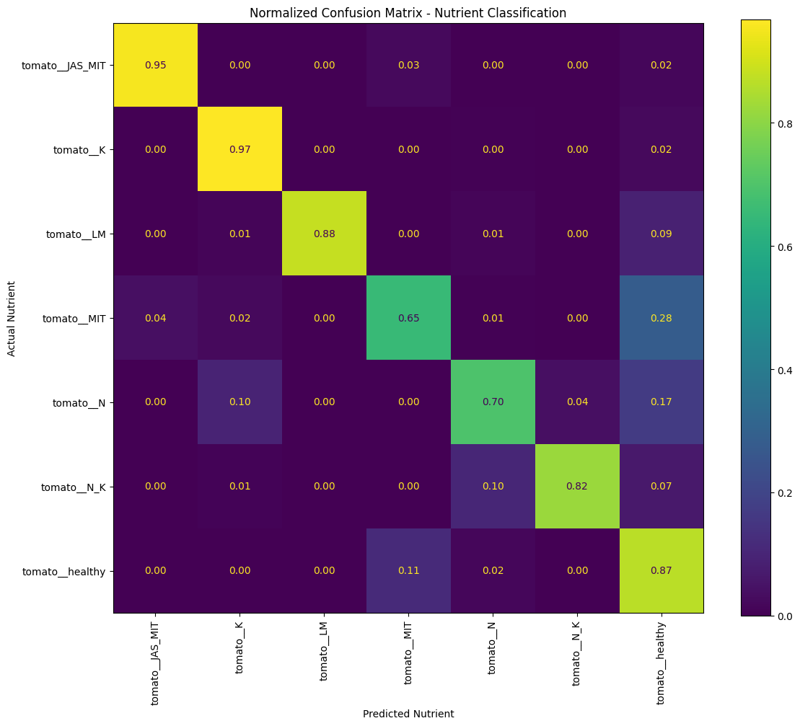
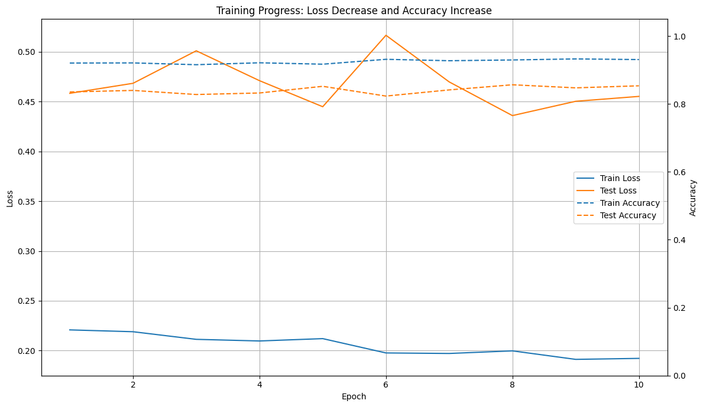

# OLID Tomato Nutrient Deficiency Classifier

Transfer learning with a pretrained **ResNet-18** to recognise nutrient-deficiency symptoms on tomato leaves. The leaf photos come from the **OLID I** open leaf image dataset. The model sorts a leaf into one of **7 classes**: six nutrient-stress classes and healthy.

## Results

Evaluated on a held-out 20% split (331 images, 7 classes, balanced at about 236 images per class in my working copy):

| Class | Precision | Recall | F1 |
|---|---|---|---|
| tomato__JAS_MIT | 0.98 | 0.96 | 0.97 |
| tomato__K | 0.91 | 1.00 | 0.95 |
| tomato__LM | 1.00 | 0.88 | 0.94 |
| tomato__MIT | 0.83 | 0.62 | 0.71 |
| tomato__N | 0.90 | 0.71 | 0.80 |
| tomato__N_K | 0.95 | 0.86 | 0.90 |
| tomato__healthy | 0.53 | 0.89 | 0.67 |
| **Overall accuracy** | | | **85%** (macro F1 0.85) |

The best checkpoint during training reached **87.8%** test accuracy. Class names are the folder labels used in the dataset.

**Honest notes**
- The weak spot is **MIT** and **N** leaves being called healthy. Mild deficiency looks a lot like a healthy leaf, so healthy precision is only 0.53.
- Test accuracy moved between about 79% and 88% from epoch to epoch (see the curves below), so the numbers are noisy. The test split was also used to pick the best checkpoint, so 87.8% is optimistic. A separate validation split would be the right fix.

## Method

- **Model:** ResNet-18 with ImageNet weights. All layers are frozen except `layer4` and a new 7-way `fc` head.
- **Augmentation (train):** resize to 256, random crop 224, random rotation (180°), horizontal and vertical flips, colour jitter, random affine (shift and scale). Test images are resized to 224 only. ImageNet normalisation is used in both.
- **Training:** Adam (lr 1e-4), cross-entropy, `ReduceLROnPlateau` on the test loss, 10 epochs, 80/20 random split with `random_state=42`. The best checkpoint is saved by test accuracy.
- **Logging:** per-image loss and correctness are written to CSV each epoch (`results/image_results_test.csv`), and the confusion matrix and curves are plotted from those CSVs.

## What's inside

| Path | Content |
|---|---|
| `Model_olid.ipynb` | Full notebook: data loading, augmentation, training, evaluation, plots |
| `results/classification_report.txt` | Per-class precision, recall and F1 |
| `results/data.csv` | Per-epoch train loss, test loss and test accuracy |
| `results/image_results_test.csv` | Per-image test predictions for every epoch |
| `docs/` | Confusion matrix and training curves |

## Dataset and weights

- The images are **not** included. Download **OLID I** from its source: [paper (Frontiers in Plant Science, 2023)](https://www.frontiersin.org/journals/plant-science/articles/10.3389/fpls.2023.1251888/full) and [Zenodo record](https://zenodo.org/record/8105154). Arrange the tomato images as `Tomato/<class_name>/*.jpg` (the notebook reads this with `ImageFolder`).
- Trained weights are about 43 MB each and are not stored in git.
- The notebook imports `accuracy_fn` from a `helper_functions.py` of the [Learn PyTorch](https://www.learnpytorch.io/) course. Replace that import with your own accuracy function, or copy the helper from [MNIST-Digit-Classifier](https://github.com/Shaikh-Mohammad-Hasnat/MNIST-Digit-Classifier).

## Next steps
- Add a proper validation split and report the test score once.
- Try ResNet-34 or EfficientNet, and class-weighted loss for the healthy class.
- Wrap the model in a small web app for upload-and-predict.

## Tech
Python, PyTorch, torchvision, scikit-learn, pandas, matplotlib.

## Author
Shaikh Mohammad Hasnat, [GitHub](https://github.com/Shaikh-Mohammad-Hasnat), [LinkedIn](https://www.linkedin.com/in/shaikh-mohammad-hasnat-698a08335)
